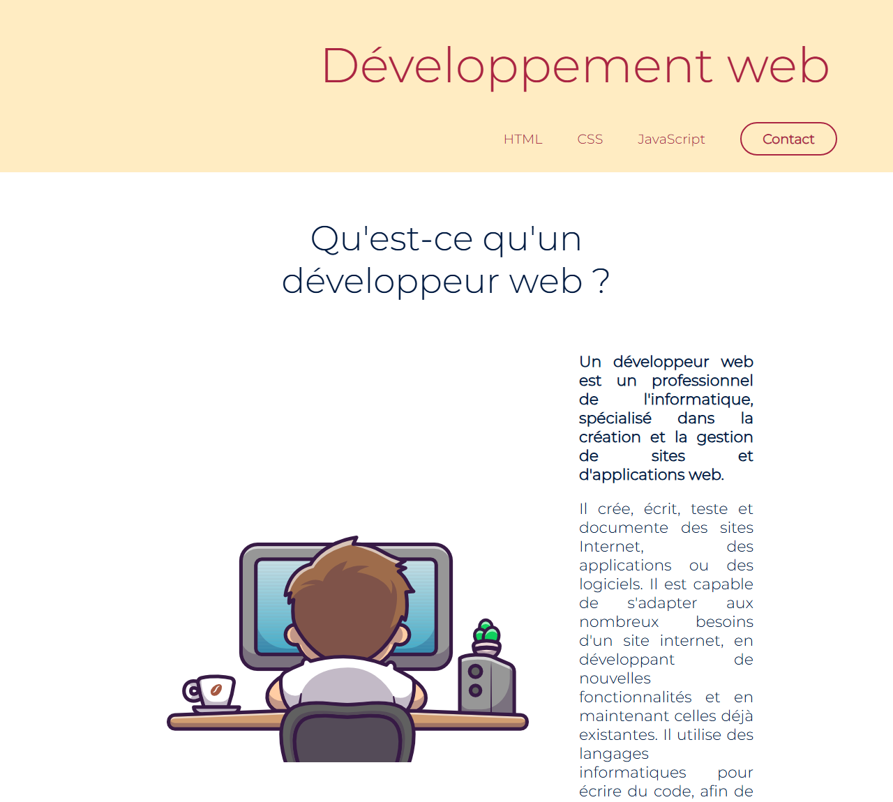
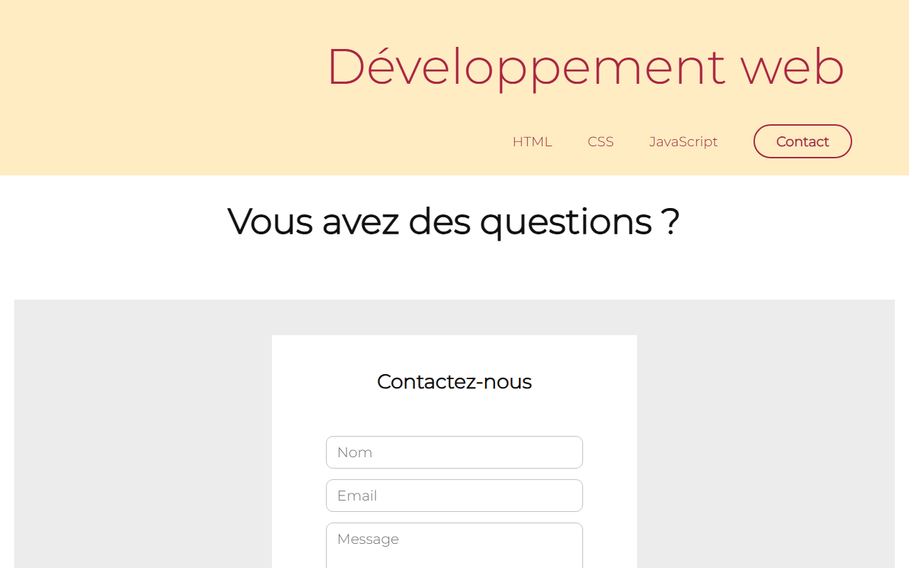
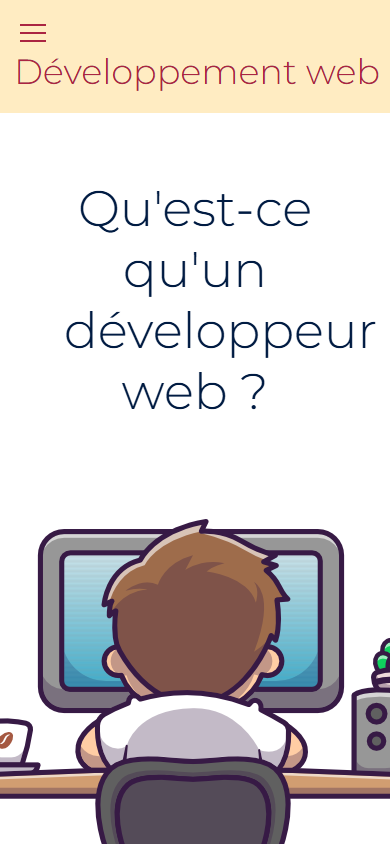

# Développement web

My very first website, made at the start of my web developer training.
A small educational site that explains what a web developer does, and what HTML, CSS and JavaScript are.

**[▶ Visit the site](https://suzonz.github.io/Projet-HTML-CSS/)**



| Contact page | On a phone |
|---|---|
|  |  |

The site is in French.

## Pages

| Page | Content |
|---|---|
| Home | What a web developer does, front-end and back-end |
| HTML | What HTML is, tags, the anatomy of an element, a video |
| CSS | What CSS is, its syntax, a video |
| JavaScript | What JavaScript is and what it is used for, a video |
| Contact | A contact form with a confirmation pop-up (it does not send anything) |

## What it shows

- HTML only, and CSS only: no framework, no JavaScript
- Responsive layout: under 768 px wide, the menu turns into a burger button,
  made in pure CSS with a hidden checkbox
- The contact pop-up is pure CSS too (the `:target` selector)
- Montserrat font, embedded in the project
- Videos embedded from YouTube

## Project structure

```
index.html            home page
html.html             about HTML
ccs.html              about CSS
javascript.html       about JavaScript
contact.html          contact form
css/style.css         all the styles, with the phone layout at the end
fonts/                Montserrat
images/               illustrations and examples
screenshots/          images used in this README
```

## Run it

Open the link above, or open `index.html` in a browser. Nothing to install.
The videos need the page to be served by a web server (they show an error when the file is opened directly).

## Credits

- Site, texts and code: **Suzonz**
- Videos: [Informatique Sans Complexe](https://www.youtube.com/@InformatiqueSansComplexe), embedded from YouTube
- Font: [Montserrat](https://fonts.google.com/specimen/Montserrat), under the SIL Open Font License

## License

The code is released under the [MIT License](LICENSE).
The videos and the font keep their own licenses.
